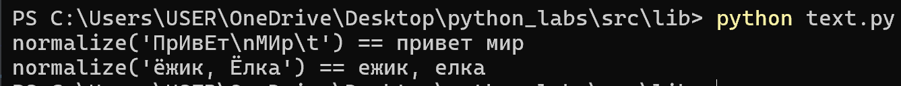
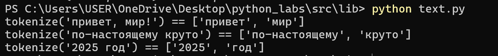
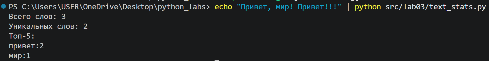

# Кудрявцев Евгений
# Группа БИВТ-26-6-1

# Третья лабораторная работа

# 1 Задание

1.1 normalize

Убирает из строки лишние пробелы, приводит буквы к строчным версиям и убирает невидимые управляющие символы (например \n и \t).

При casefold == True использует вместо lower casefold.

При yo2e == True заменяет ё/Ё на е/Е.

```python
def normalize(text: str, *, casefold: bool = True, yo2e: bool = True):
    if casefold:
        text = text.casefold()
    else:
        text = text.lower()
    if yo2e:
        text = text.replace('ё','е')
    text = text.strip()
    text = ' '.join(text.split())
    return text
```

Пример работы



1.2 tokenize

Разбивает слова по небуквенно-цифровым разделителям, за слова считает последоваетльности символов из букв, цифр, подчеркивания и дефиса внутри слова. Возвращает список.

```python
def tokenize(text: str):
    return findall(r"\w+(?:-\w+)*", text)
```

Пример работы



1.3 count_freq

Подсчитывает частоты строк в списке и возвращает словарь с ключами в виде уникальных значений списка и аргументами в виде количества данных элементов в словаре.

```python
def count_freq(tokens: list[str]):
    freq = {}
    for w in tokens:
        freq[w] = freq.get(w,0)+1
    return freq
```

1.4 top_n

Возвращает топ-N по убыванию частоты в словаре, при равенстве частот возвращает по алфавиту слова.

```python
def top_n(freq: dict[str, int], n: int = 5):
    return sorted(freq.items(), key = lambda x: (-x[1], x[0]))[:n]
```

Примеры работы обеих функций


# 2 Задание

Данная программа для анализа текста использует функции, описанные до этого. Она приводит текст к нижнему регистру и удаляет всё лишнее, подстчитывает количество слов, количество уникальных слов, а также выводит топ-5 слов по частоте употребления

```python
text = sys.stdin.read()
ntext = normalize(text)
words = tokenize(ntext)
freq = count_freq(words)
top5 = top_n(freq,5)

print(f"Всего слов: {len(words)}")
print(f"Уникальных слов: {len(freq)}")
print("Топ-5: ")

for w,c in top5:
    print(f"{w}:{c}")
```

Для быстрого тестирования используется команда echo, которая передаёт указанный текст в программу через стандартный поток ввода (stdin).


