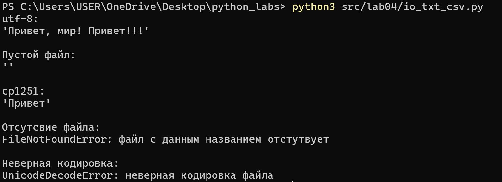
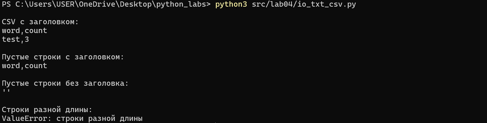
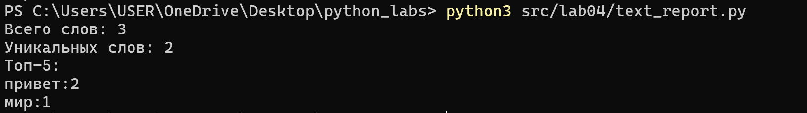
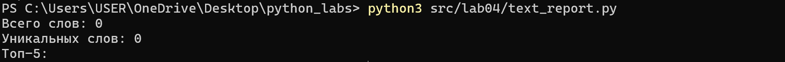
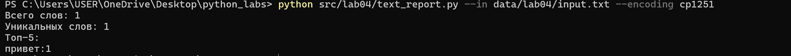

# Кудрявцев Евгений
# Группа БИВТ-26-6-1

# Четвёртая лабораторная работа

# Задание A

read_txt

Читает содержимое текстового файла и возвращает его в виде одной строки

```python
def read_text(path: str | Path, encoding: str = "utf-8") -> str:
    p = Path(path)
    return p.read_text(encoding=encoding)
```

Мини-тесты функции read_text



write_csv

Создаёт или перезаписывает CSV-файл с разделителем-запятой

Может добавить заголовок, а также проверяет, чтобы все строки имели одинаковое количество столбцов

```python
def write_csv(rows: Iterable[Sequence], path: str | Path, header: tuple[str, ...] | None = None) -> None:
    p = Path(path)
    rows = list(rows)

    if rows:
        columns = len(rows[0])
        for r in rows:
            if len(r) != columns:
                raise ValueError("Строки имеют разное количество столбцов")

    ensure_parent_dir(p)

    with p.open("w", newline="", encoding="utf-8") as f:
        w = csv.writer(f, delimiter=",")
        if header is not None:
            w.writerow(header)
        for r in rows:
            w.writerow(r)
```

Мини-тесты функции write_csv



ensure_parent_dir(★)

Создаёт родительские папки пути, если они отсутствуют. Если папки уже существуют, то функция не выдаёт ошибку

```python
def ensure_parent_dir(path: str | Path) -> None:
    p = Path(path)
    p.parent.mkdir(parents=True, exist_ok=True)
```

# Задание B

text_report

Функция считывет текст из txt-файла, нормализирует его, делит на отдельные слова и ситает частоту слов

Выводится количество слов и уникальных слов, а также топ-5 слов по частоте. В csv-файл записывается результат

```python
parser = argparse.ArgumentParser()

parser.add_argument("--in", dest="input_path",
                            default="data/lab04/input.txt")

parser.add_argument("--out", dest="output_path",
                            default="data/lab04/report.csv")

parser.add_argument("--encoding", default="utf-8")

args = parser.parse_args()

text = read_text(args.input_path, encoding=args.encoding)

freq = count_freq(tokenize(normalize(text)))

rows = sorted(freq.items(), key=lambda p: (-p[1], p[0]))

write_csv(rows, args.output_path, header=("word","count"))

print(f"Всего слов: {sum(freq.values())}")
print(f"Уникальных слов: {len(freq)}")
print("Топ-5:")
for w, c in top_n(freq, 5):
    print(f"{w}:{c}")
```

Тесты:

A. Один файл

Ввод:

```
Привет, мир! Привет!!!
```



Содержимое отчета (data/lab04/report.csv):

```
word,count
привет,2
мир,1
```

B. Пустой файл

На вход подаётся пустой файл



Содержимое отчета (data/lab04/report.csv):

```
word,count
```

C. Кодировка cp1251

Содержание файла "Привет" в кодировке cp1251:

```
Привет
```

Запуск файла с кодировкой cp1251 происходит командой в консоли

```
 python src/lab04/text_report.py --in data/lab04/input.txt --encoding cp1251
```



Отчёт (data/lab04/report.csv):

```
word,count
привет,1
```

Без --encoding файл не cчитается
