# Кудрявцев Евгений
# Группа БИВТ-26-6-1

# Пятая лабораторная работа

# Задание A

`json_to_csv`

Преобразует файл json со списком словарей в таблицу csv. Делает проверку на правильность типа файла и корректность структуры json. Использует ключи из словарей как заголовки для csv. При отсутвии поля записывает пустую строку.

```python
def json_to_csv(json_path: str, csv_path: str) -> None:
    """Преобразует json в csv"""

    if Path(json_path).suffix.lower() != ".json" or Path(csv_path).suffix.lower() != ".csv":
        raise ValueError("Неверный тип файла")

    if not Path(json_path).is_file():
        raise FileNotFoundError(f"Файл не найден: {csv_path}")

    text = read_text(json_path)

    if not text.strip():
        raise ValueError("Пустой json-файл")

    try:
        data = json.loads(text)
    except json.JSONDecodeError:
        raise ValueError("Ошибочный json-файл")

    if not all(isinstance(item, dict) for item in data):
        raise ValueError("json-файл должен содержать список словарей")

    fieldnames = sorted(set(
        key for item in data for key in item
    ))

    if not fieldnames:
        raise ValueError("json-файл не содержит полей")

    rows = [
        [item.get(key, "") for key in fieldnames]
        for item in data
    ]

    write_csv(rows, csv_path, header=tuple(fieldnames))
```

Тестирование `json_to_csv`

Программа преобразует `people.json`

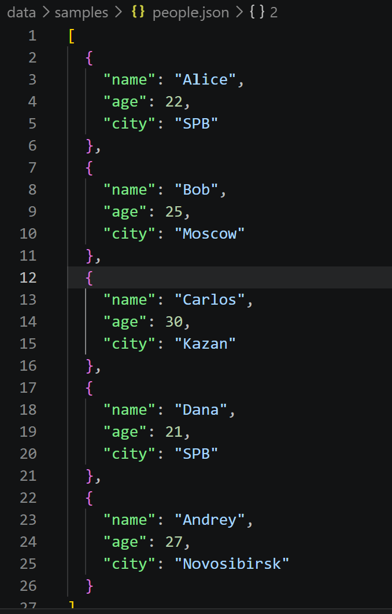

в `people_from_json.csv`

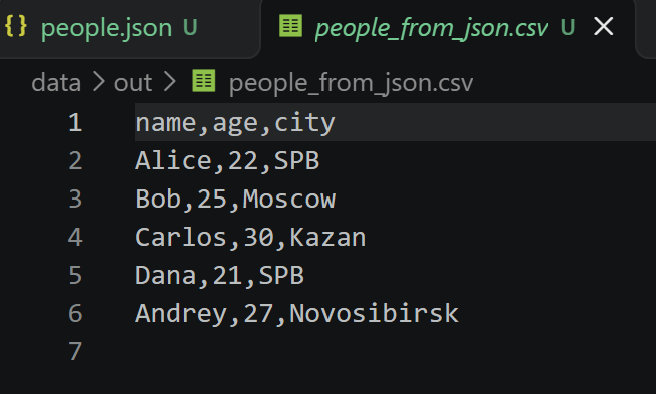

При неверном типе файла `ValueError`

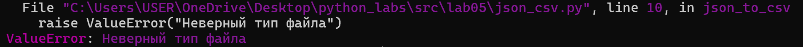

При пустом json-файле `ValueError`

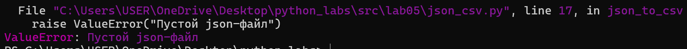

При отсутвующем файле `FileNotFoundError`

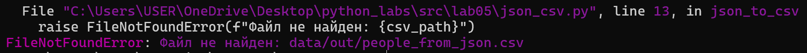

`csv_to_json`

Преобразует csv файл в json. Проверяет тип входного файла и данные. Названия столбцов становятся ключами словарей.

```python
def csv_to_json(csv_path: str, json_path: str) -> None:
    """Преобразует csv в json"""

    if Path(csv_path).suffix.lower() != ".csv" or Path(json_path).suffix.lower() != ".json":
        raise ValueError("Неверный тип файла")

    if not Path(csv_path).is_file():
            raise FileNotFoundError(f"Файл не найден: {csv_path}")

    text = read_text(csv_path)

    try:
        reader = csv.DictReader(text.splitlines(keepends=True), strict=True)
        fieldnames = reader.fieldnames

        if not fieldnames or not all(fieldnames):
            raise ValueError("csv-файл не содержит корректного заголовка")

        if len(fieldnames) != len(set(fieldnames)):
            raise ValueError("Повторяющиеся заголовки csv-файла")

        data = list(reader)
    except csv.Error as e:
        raise ValueError("Некорректный csv-файл") from e

    if not data:
        raise ValueError("csv-файл не содержит данных")

    if any(None in row for row in data):
        raise ValueError("Слишком много столбцов в csv-файле")

    for row in data:
        for key in fieldnames:
            if row[key] is None:
                row[key] = ""

    ensure_parent_dir(json_path)

    with Path(json_path).open("w", encoding="utf-8") as f:
        json.dump(data, f, ensure_ascii=False, indent=2)

```

Тестирование `csv_to_json`

Преобразует `people.csv`

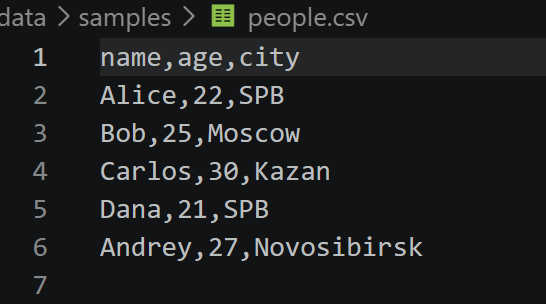

в `people_from_csv.json`

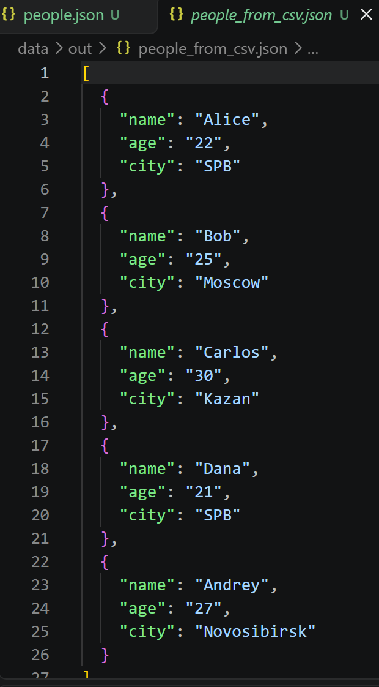

При неверном типе файла `ValueError`

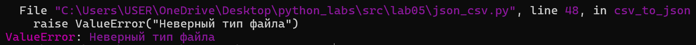

При пустом csv-файле `ValueError`

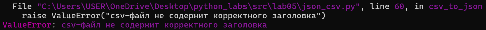

При отсутвующем файле `FileNotFoundError`

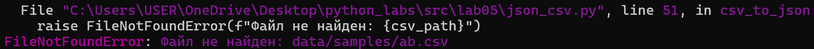


# Задание B

`csv_to_xlsx`

Преобразует csv в xlsx.

```python
def csv_to_xlsx(csv_path: str, xlsx_path: str) -> None:
    """Преобразует csv-файл в xlsx."""

    if Path(csv_path).suffix.lower() != ".csv" or Path(xlsx_path).suffix.lower() != ".xlsx":
        raise ValueError("Неверный тип файла")

    if not Path(csv_path).is_file():
            raise FileNotFoundError(f"Файл не найден: {csv_path}")

    text = read_text(csv_path)
    rows = list(csv.reader(text.splitlines()))

    if not rows or not rows[0] or not any(rows[0]):
        raise ValueError("csv-файл не содержит заголовка")

    if len(rows) < 2:
        raise ValueError("csv-файл не содержит данных")

    wb = Workbook()
    ws = wb.active
    ws.title = "Sheet1"

    for row in rows:
        ws.append(row)

    # Настраиваем ширину столбцов
    for col in ws.columns:
        max_length = max(
            len(str(cell.value)) if cell.value is not None else 0
            for cell in col
        )

        col_letter = get_column_letter(col[0].column)
        ws.column_dimensions[col_letter].width = max(8, max_length + 2)


    ensure_parent_dir(xlsx_path)
    wb.save(xlsx_path)
```

Тестированеие `csv_to_json`

Преобразует `cities.csv`

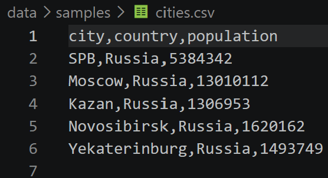


в `cities.xlsx`

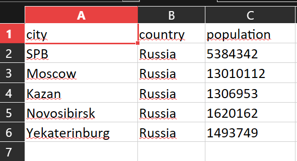

При неверном типе файла `ValueError`

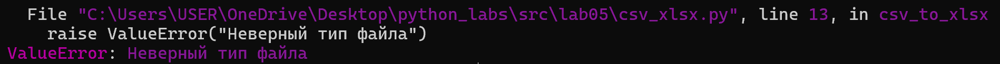

При пустом csv-файле `ValueError`

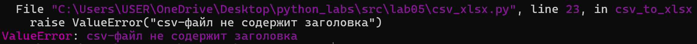

При отсутвующем файле `FileNotFoundError`

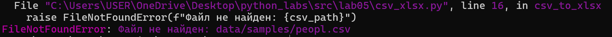

