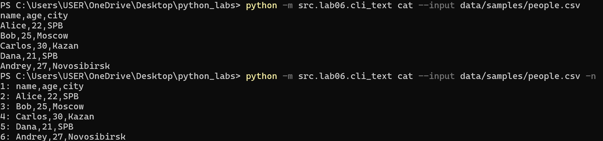
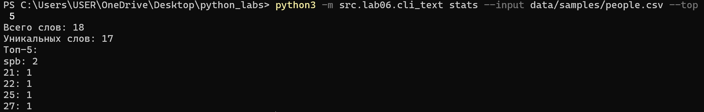
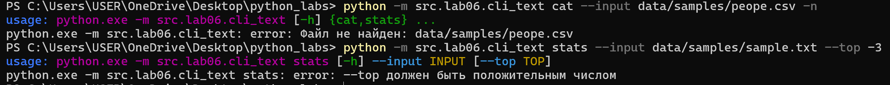
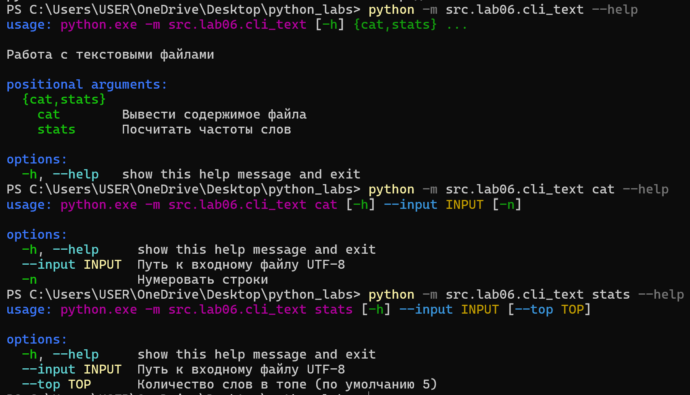
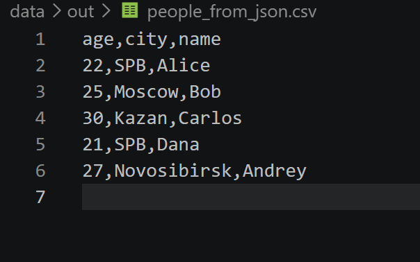
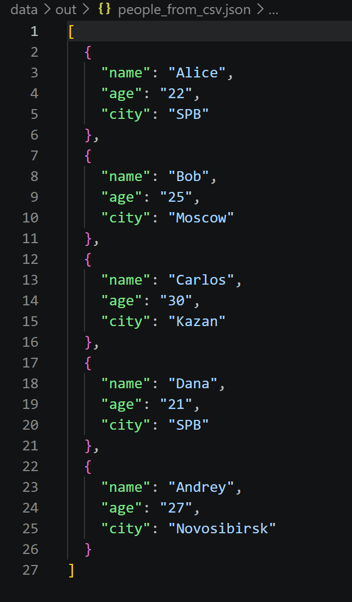
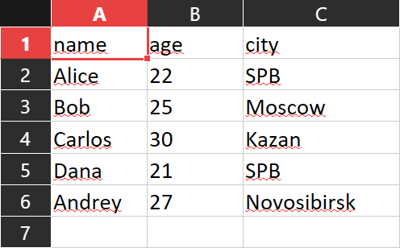
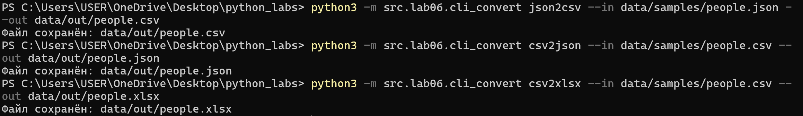
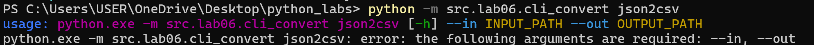
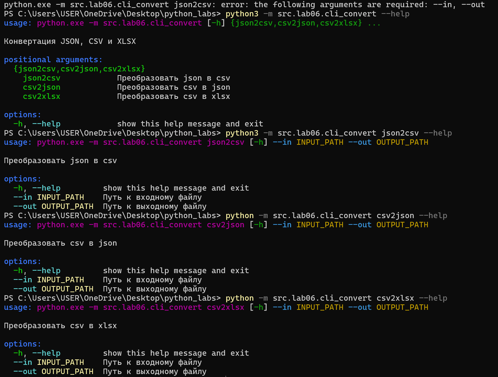

# Кудрявцев Евгений
# Группа БИВТ-26-6-1

# Шестая лабораторная работа

# Задание A

В файле `src/lab06/cli_text.py` имеются 2 подкоманды: `cat` и `stats`

`cat --input <путь> -n` Печатает файл по строкам, `-n` нумерует строки, начиная с 1

Пример команды в консоли
```
python3 -m src.lab06.cli_text cat --input data/samples/people.csv -n
```

Вывод без нумерации и с ней



`stats --input <путь> --top n` Пишет число слов и число уникальных слов и n-число самых частых слов с количеством. По умолчанию n = 5

Пример команды в консоли
```
python3 -m src.lab06.cli_text stats --input data/samples/people.csv --top 5
```



*Проверка ошибок*

При отсутвии файла

При отрицательном --top



*help справки*

```
python -m src.lab06.cli_text --help
python -m src.lab06.cli_text cat --help
python -m src.lab06.cli_text stats --help
```




# Задание B

В файле `src/lab06/cli_text.py` имеются 3 подкоманды: `json2csv`, `csv2json` и `csv2xlsx`, которые вызывают функции из 5 лабораторной работы

`json2csv` преобразует json-файл в csv-файл

Пример команды в консоли
```
python3 -m src.lab06.cli_convert json2csv --in data/samples/people.json --out data/out/people.csv
```



`csv2json` преобразует csv-файл в json-файл

Пример команды в консоли
```
python3 -m src.lab06.cli_convert csv2json --in data/samples/people.csv --out data/out/people.json
```



`csv2xlsx` преобразует csv-файл в xlsx-файл

Пример команды в консоли
```
python3 -m src.lab06.cli_convert csv2xlsx --in data/samples/people.csv --out data/out/people.xlsx
```





*Проверка ошибок*

Отсутвие --in и --out



*help справки*

```
python3 -m src.lab06.cli_convert --help
python3 -m src.lab06.cli_convert json2csv --help
python -m src.lab06.cli_convert csv2json --help
python -m src.lab06.cli_convert csv2xlsx --help
```


