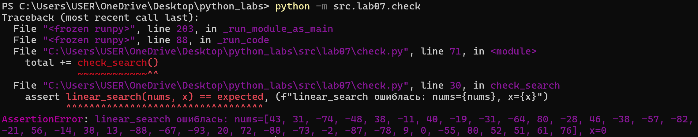
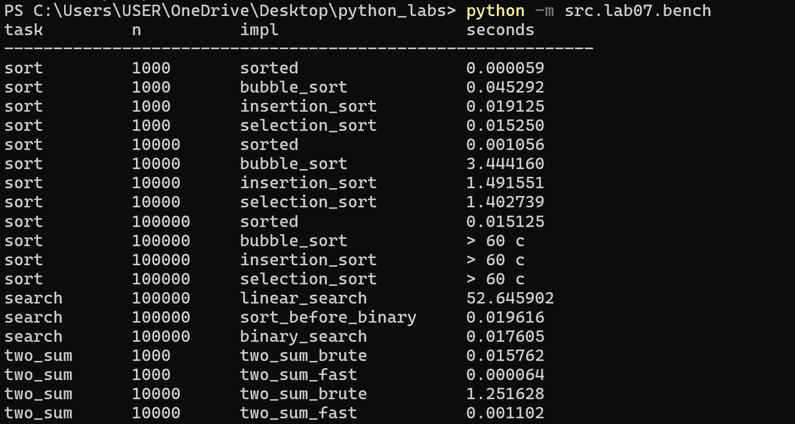

# Кудрявцев Евгений
# Группа БИВТ-26-6-1

# Седьмая лабораторная работа

# Задание A

В файле `search.py` имеются 4 функции:

1. `linear_search`

Последовательно перебирает элементы списка до нахождения числа x. Возвращает индекс первого вхождения или -1, если элемент отсутствует. Сложность O(n)

2. `binary_search`

Ищет элемент в отсортированном списке, на каждом шаге сокращая область поиска вдвое. Возвращает индекс элемента или -1. Сложность O(log n)

3. `two_sum_brute`

Перебирает все возможные пары элементов, пока не найдёт пару с заданной суммой. Возвращает индексы элементов или None. Сложность O(n²)

4. `two_sum_fast`

Ищет пару с заданной суммой с помощью словаря, в котором хранятся ранее рассмотренные числа и их индексы. Возвращает индексы пары или None. Ожидаемая сложность O(n)

# Задание B

В файле `sorting.py` имеются 3 алгоритма:

1. `bubble_sort`

Сравнивает соседние элементы и меняет их местами, если они расположены в неправильном порядке. Завершается досрочно, если за проход не произошло ни одной перестановки. Сложность O(n²)

2. `insertion_sort`

Последовательно берёт элементы и вставляет их на нужные позиции в уже отсортированной части списка. Сложность O(n²)

3. `selection_sort`

На каждом шаге находит минимальный элемент неотсортированной части списка и перемещает его на нужную позицию. Сложность O(n²)

Все алгоритмы возвращают новый отсортированный список, не изменяя исходный

# Задание C

В файле `check.py` реализована проверка корректности алгоритмов с помощью assert

`check_sorting`

Проверяет работу переданной функции сортировки на заранее заданных и случайных списках. Сравнивает результат с sorted() и проверяет сохранность исходного списка

`check_search`

Проверяет линейный и бинарный поиск на случайных данных, сравнивая результаты с ожидаемыми значениями

`check_two_sum`

Проверяет оба алгоритма поиска пары, правильность возвращаемых индексов и соответствие суммы заданному значению

Запуск:

```
python -m src.lab07.check
```

Результат проверки:


При возникновении расхождений программа выводит AssertionError с информацией об ошибочных данных



# Задание D

В файле `bench.py` реализовано сравнение времени выполнения алгоритмов с помощью модуля timeit

`measure`

Несколько раз измеряет время выполнения функции с помощью timeit.repeat() и возвращает минимальное время в расчёте на один запуск

`sort_worker`

Измеряет время сортировки в отдельном процессе и передаёт результат через очередь

`limited_time`

Выполняет несколько замеров с ограничением времени. Если процесс превышает установленный лимит, он принудительно завершается

`bench_sorts`

Сравнивает время работы трёх реализованных сортировок и встроенной функции sorted() на одинаковых данных

`bench_search`

Сравнивает время линейного и бинарного поиска при выполнении 10 000 запросов. Отдельно измеряет время предварительной сортировки

`bench_two_sum`

Сравнивает время поиска пары обычным перебором и с использованием словаря

Запуск:

```
python -m src.lab07.bench
```

Результыты сортировок сохраняются в `data/lab07/bench.csv`

Результаты сортировок:

```
task,n,impl,seconds
sort,1000,sorted,5.9299985878169537e-05
sort,1000,bubble_sort,0.04529199993703514
sort,1000,insertion_sort,0.019124799990095198
sort,1000,selection_sort,0.01525009993929416
sort,10000,sorted,0.00105640001129359
sort,10000,bubble_sort,3.4441603999584913
sort,10000,insertion_sort,1.491551399929449
sort,10000,selection_sort,1.402738800039515
sort,100000,sorted,0.015124500030651689
sort,100000,bubble_sort,> 60 с
sort,100000,insertion_sort,> 60 с
sort,100000,selection_sort,> 60 с
search,100000,linear_search,52.6459021999035
search,100000,sort_before_binary,0.019615800003521144
search,100000,binary_search,0.017605199944227934
two_sum,1000,two_sum_brute,0.015762399998493493
two_sum,1000,two_sum_fast,6.440002471208572e-05
two_sum,10000,two_sum_brute,1.2516276000533253
two_sum,10000,two_sum_fast,0.001101600006222725
```

Результаты в консоли:



Значения в секундах, если времы выполнения превышает 60 секунд, то указывается > 60 с

## Выводы

### Сравнение сортировок

Пузырьковая сортировка, сортировка вставками и сортировка выбором имеют сложность O(n²) в худшем случае. При увеличении размера списка в 10 раз время их работы выросло примерно в 75–77 раз. Встроенная функция sorted() имеет сложность O(n log n) в худшем случае и работает значительно быстрее на больших списках. Все реализованные сортировки используют O(n) дополнительной памяти, так как создают копию исходного списка.

### Сравнение алгоритмов поиска

Линейный поиск имеет сложность O(n), а бинарный — O(log n). При выполнении 10 000 запросов бинарный поиск оказался примерно в 1382 раза быстрее линейного даже с учётом предварительной сортировки. Поэтому при большом количестве запросов выгоднее один раз отсортировать список и использовать бинарный поиск.

### Сравнение алгоритмов Two Sum

Первый алгоритм перебирает пары элементов и имеет сложность O(n²) в худшем случае. Второй использует словарь, благодаря чему его средняя сложность составляет O(n). При этом он требует больше дополнительной памяти, но работает значительно быстрее на больших списках.

### Проверка корректности

Все алгоритмы были проверены на различных входных данных. Результаты сравнивались с правильными ответами. Специально добавленная ошибка была обнаружена с помощью assert, после чего исправлена.
